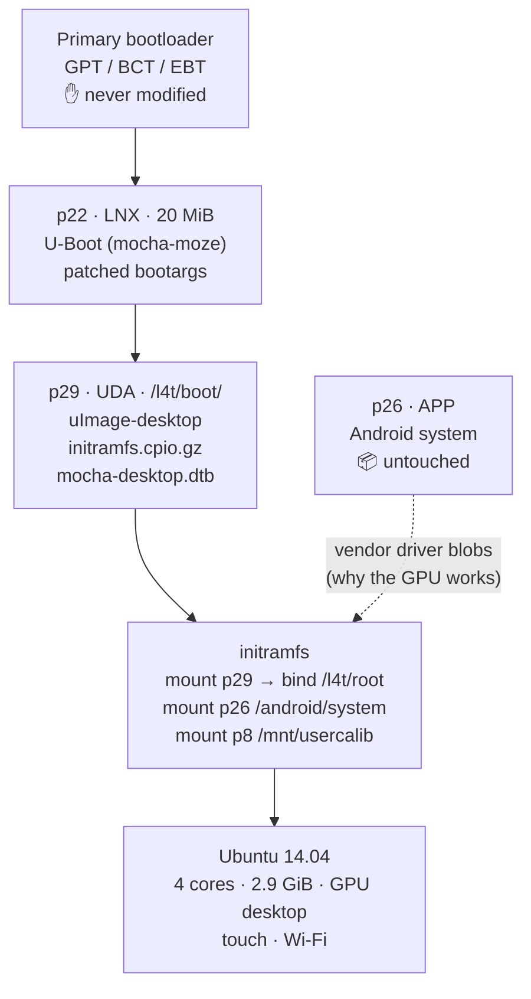

# L4T Ubuntu 14.04 on Xiaomi Mi Pad 1 (mocha) — 4 cores, 3 GB RAM, GPU desktop, working power button

A complete, reproducible guide for running **Ubuntu 14.04 LTS (NVIDIA L4T R24.1)** on the
**Xiaomi Mi Pad 1 (codename `mocha`, Tegra K1 / Tegra124)**, with:

* ✅ **4 CPU cores** online (no `tos.img` flashing needed)
* ✅ **3 GB RAM** usable (`MemTotal ≈ 2.9 GiB` on a 3 GB modded unit)
* ✅ **GPU-accelerated Unity desktop** (NVIDIA Tegra K1 / nvpgpu)
* ✅ **Touchscreen** (Atmel mxt1664t) and **Wi-Fi** working
* ✅ **Working power button**: shut down → press power → boots again
* ✅ **Android kept intact** — L4T lives inside the data partition

> 中文版: [README.zh-CN.md](README.zh-CN.md)

---

## 1. Executive summary — what actually matters

After a full day of experiments (kernel rebuilds, DTB surgery, PMIC register archaeology)
the working configuration turned out to be **much simpler than the L4T package README suggests**:

| Myth | Reality |
|---|---|
| "You must flash `tos.img` or only 1 core works" | **False.** The stock L4T kernel already brings up 4 cores. `tos.img` bricks this device. |
| "You must build the kernel yourself" | **Do not.** The prebuilt `zImage` in `L4T_R241.zip` works; rebuilt kernels either fail to compile against this source or fail to boot. |
| "Generic bootargs are enough" | **False.** The L4T kernel needs its vendor-specific board bootargs (`tegraid`, `touch_id`, `otf_key`, `tegra_fbmem`, `displayboard`, `board_info`, `panel_id` …). |
| "2 GB is the maximum" | **False.** The kernel has `CONFIG_ARM_LPAE=y`; a DTB memory-node patch unlocks 3 GB. |
| "Power off then power on works" | **Not by default.** The vendor `palmas_power_off` puts the PMIC in a state the power button cannot wake from. Fixed by a DTB property removal. |

**Golden rule: use the ORIGINAL kernel + ORIGINAL DTB + ORIGINAL initramfs from the L4T package,
and change only the four small things described below.**

---

## 2. Requirements

### Hardware
* Xiaomi Mi Pad 1 (`mocha`, A0101, Tegra K1 / Tegra124)
* micro-USB cable, a host PC with `fastboot`
* Optional: 3 GB RAM hardware mod (guide works with 2 GB too, just skip step 5.4)

### Software on the host
* `fastboot` (Android platform-tools)
* A Linux environment (WSL2 is fine) with:
  * `device-tree-compiler` (`dtc`, `fdtput`)
  * `u-boot-tools` (`mkimage`)
  * `git`, `python3`, `cpio`, `gzip`
* **Linaro GCC 4.9** — only needed if you want to rebuild the U-Boot
  (`arm-cortex-linux-gnueabi` or `arm-linux-gnueabihf` 4.9)

### Files you need to obtain
| File | Where |
|---|---|
| `L4T_R241.zip` (L4T R24.1 package for mocha by **arttttt / Insei**) | the original project thread / archive |
| `L4T-kernel-mocha-master.zip` (kernel source, 3.10.107) | GitHub `L4T-kernel-mocha` |
| `mocha-moze-boot` (U-Boot sources) | GitHub `mocha-moze-boot` |
| Stock Android fastboot ROM (`mocha_images_V9.2.4.0…`) | Xiaomi |
| `root_00.tar.gz` (from inside `L4T_R241.zip`, `root_dir/`) | the L4T package |

From `L4T_R241.zip` extract to `L4T_R241/`:
```
root_dir/boot/zImage              # original kernel (7,818,464 bytes)
root_dir/boot/tegra124-mocha.dtb  # original DTB (144,537 bytes)
root_dir/boot/initramfs.cpio.gz   # original initramfs (1,027,580 bytes)
root_dir/root_00.tar.gz           # Ubuntu 14.04 rootfs
root_dir/rom_info.txt             # the authoritative bootargs
```

---

## 3. Device partition layout (mocha)

Read it from your own device before trusting any guide:

```sh
cat /proc/partitions
blkid
```

Reference layout (16 GB / 64 GB units share the same first 29 partitions):

| Partition | Size | Use |
|---|---|---|
| p8 | 2 MB | calib |
| p18 | 8 MB | factory |
| **p22** | 20 MB | **LNX — boot image (our U-Boot lives here)** |
| **p26** | 1.25 GB | **APP — Android system** (do not touch) |
| **p29** | rest (~56 GB) | **UDA — Android userdata + our L4T (`/l4t/`)** |

`storage.sh` (see `scripts/`) refuses to write if the layout differs from the stock one —
that is intentional, it protects the partition table. **Never write the GPT.**

### Disk layout (byte offsets, not to scale)

```
 byte offset
 0                                                                                 58.2 GiB
 │                                                                                     │
 ├──────────┬────────┬─────────────────┬───────────────────────────────────────────────┤
 │bootloader│  p22   │      p26        │                    p29                        │
 │GPT / BCT │  LNX   │      APP        │                    UDA                        │
 │   EBT    │ 20 MiB │   1.25 GiB      │                  ~56 GiB                      │
 │0–192 MiB │192–212 │ 256 MiB–1.49 GiB│          1.49 GiB – 58.2 GiB                  │
 │          │  MiB   │                 │                                               │
 │✋ NO TOUCH│🧭U-Boot │  📱Android system│  📦Android data (56 GB) + L4T (/l4t/root)      │
 └──────────┴────────┴─────────────────┴───────────────────────────────────────────────┘
                              ▲                              ▲
                    we write p22 (20 MiB)          our whole L4T lives inside p29,
                    to boot our U-Boot             next to Android's user data
```

> The GPT itself is **never modified** — only the *contents* of p22 (boot image) and p29 (data).

---

## 4. The boot chain we use

```
Primary bootloader (EBT, untouched)
  └─ p22 / LNX: U-Boot (mocha-moze, patched bootargs)
       └─ mmc 0#UDA : /l4t/boot/uImage-desktop     (original kernel, mkimage-wrapped zImage)
                      /l4t/boot/initramfs.cpio.gz  (original initramfs, partition numbers patched)
                      /l4t/boot/mocha-desktop.dtb  (original DTB + 3 GB memory node + power fix)
            └─ initramfs mounts /dev/mmcblk0p29, bind-mounts /l4t/root, switch_root
                 └─ Ubuntu 14.04 on p29:/l4t/root   (Android untouched on p26)
```

Everything lives on the **data partition** — exactly the scheme the original multirom L4T used
(`rom_info.txt`: `root_dir="%m/root"`).

### Boot flow diagram



---

## 5. Step by step

### 5.1 Patch the original initramfs (partition numbers)

The stock initramfs hardcodes **Shield Tablet** partition numbers and adds an LTE offset when
`/dev/mmcblk0p25` exists — on mocha it does, so every number shifts and the mounts fail.

```sh
mkdir og-init && cd og-init
zcat /path/to/L4T_R241/root_dir/boot/initramfs.cpio.gz | cpio -idm --quiet
```

Edit `init`, replace the partition block with mocha's real map:

```sh
# mocha (Mi Pad 1) partition map, from live GPT
DATAPART=/dev/mmcblk0p29
SYSPART=/dev/mmcblk0p26
FACTORYPART=/dev/mmcblk0p18
CALIBPART=/dev/mmcblk0p8
CACHEPART=/dev/mmcblk0p28
```

Also make the four extra mounts non-fatal:

```sh
[ -b $CACHEPART ] && $BB mount -t ext4 -o noatime,nodiratime $CACHEPART /root/android/cache 2>/dev/null
[ -b $SYSPART ] && $BB mount -t ext4 -o noatime,nodiratime,ro $SYSPART /root/android/system 2>/dev/null
[ -b $FACTORYPART ] && $BB mount -t ext4 -o ro $FACTORYPART /root/mnt/factory 2>/dev/null
[ -b $CALIBPART ] && $BB mount -t ext4 -o ro $CALIBPART /root/mnt/usercalib 2>/dev/null
```

Repack:

```sh
find . | cpio -o -H newc --quiet | gzip -9 > initramfs-mocha-data.cpio.gz
```

### 5.2 Wrap the original kernel as a uImage

The stock `zImage` is a self-decompressing image; U-Boot's `bootm` accepts it as a `-C none` uImage:

```sh
mkimage -A arm -O linux -T kernel -C none \
        -a 0x80008000 -e 0x80008000 \
        -n "L4T-ORIGINAL" \
        -d L4T_R241/root_dir/boot/zImage uImage-desktop
```

### 5.3 DTB part 1 — 3 GB memory node

Decompile the **original** DTB and patch the memory node:

```dts
memory@0x80000000 {
    device_type = "memory";
    reg = <0x0 0x80000000 0x0 0x7d000000      /* low 2 GB (2000 MB) */
           0x1 0x0 0x0 0x40000000>;            /* high 1 GB @ 4 GiB */
};
```

Recompile and check that the node count is unchanged (887 for the stock DTB):

```sh
dtc -I dtb -O dts -o og.dts tegra124-mocha.dtb
# edit memory node
dtc -I dts -O dtb -o dtb-3gb.dtb og.dts
dtc -I dtb -O dts dtb-3gb.dtb | grep -c '{'   # must still be 887
```

### 5.4 DTB part 2 — make the power button work (important!)

Remove the palmas power-off binding so the kernel **halts** instead of entering the
PMIC soft-off state that the power button cannot wake from:

```sh
dtc -I dtb -O dts -o fix.dts dtb-3gb.dtb
# inside node  /i2c@7000d000/tps65913/power_pm  delete the line:  system-pmic-power-off;
dtc -I dts -O dtb -o dtb-final.dtb fix.dts
```

Result: `MemoTotal` unchanged, but `poweroff` no longer calls `palmas_power_off`.

### 5.5 U-Boot (p22) — load from the data partition

Patch `overlay/board/xiaomi/mocha/mocha_emmc_boot.env` in the `mocha-moze-boot` repo:

```
boot_debian=setenv fdt_high ffffffff; setenv initrd_high ffffffff; \
  if mmc dev 0 && ext4load mmc 0#UDA 80007fc0 /l4t/boot/uImage-desktop && \
  ext4load mmc 0#UDA 88000000 /l4t/boot/initramfs.cpio.gz; then setenv rdsize ${filesize}; \
  if ext4load mmc 0#UDA 8c000000 /l4t/boot/mocha-desktop.dtb; then \
  fdt addr 8c000000; fdt resize 10000; \
  setenv bootargs <BOOTARGS>; \
  bootm 80007fc0 88000000:${rdsize} 8c000000; fi; fi
```

`<BOOTARGS>` — the exact `base_cmdline` from `rom_info.txt`, with `mem=…` **removed**
and root redirected to the data partition:

```
tegraid=40.1.1.0.0 otf_key=c765c04dccd12501f0ba2154786d2c92 panel_id=32 memtype=0
tsec=32M@4064M tzram=4M@4058M ddr_die=1024M@2048M section=128M fbcon=rotate:1
commchip_id=0 emc_max_dvfs=0 touch_id=0@2150632068 video=tegrafb no_console_suspend=1
console=ttyS0,115200n8 console=tty0 debug_uartport=lsport,3 sku_override=0
usbcore.old_scheme_first=1 lp0_vec=2896@0xfdfff000 tegra_fbmem=25296896@0xad012000
nvdumper_reserved=0xfd700000 core_edp_mv=1150 core_edp_ma=4000
pmuboard=0x06c8:0x03e8:0x00:0x44:0x04 displayboard=0x8038:0x0000:0x00:0x00:0x00
power_supply=Battery board_info=0x06f4:0x044c:0x03:0x41:0x07
tegraboot=sdmmc gpt gpt_sector=41983 modem_id=1 watchdog=disable
nck=1048576@0xfd700000 rw root=/dev/mmcblk0p29 rootsubdir=/l4t/root
rootfstype=ext4 rootflags=defaults,noatime,nodiratime
```

> ⚠️ **Gotcha:** U-Boot's `dev:part` syntax parses the partition number as **hex**.
> `mmc 0:29` becomes partition 0x29 = 41 → `** Invalid partition 41 **`.
> Use the GPT partition **name**: `mmc 0#UDA`.

Build:

```sh
cd mocha-moze-boot
JOBS=8 bash tools/build.sh /tmp/uboot-out
python3 tools/pack-android.py /tmp/uboot-out/u-boot-dtb.bin \
        /tmp/uboot-out/u-boot /tmp/uboot-out/mocha-uboot.img
```

### 5.6 Write p22 and install the rootfs

Use the project's read-only RAM installer (`ram-install.cpio.gz` + `storage.sh`) to write
`LNX` (p22). Then, from any Linux that can mount p29 (the RAM installer works):

```sh
mount /dev/mmcblk0p29 /mnt
mkdir -p /mnt/l4t/boot /mnt/l4t/root
cp uImage-desktop initramfs-mocha-data.cpio.gz dtb-final.dtb /mnt/l4t/boot/
cd /mnt/l4t/root && tar -xzf -        # stream root_00.tar.gz from the host
```

Wi-Fi firmware — the L4T kernel looks in `/etc/firmware` (and `/system/vendor/firmware`);
the rootfs ships the files in `/lib/firmware`:

```sh
mkdir -p /mnt/l4t/root/etc/firmware
ln -sf /lib/firmware/fw_bcmdhd.bin /mnt/l4t/root/etc/firmware/fw_bcmdhd.bin
ln -sf /lib/firmware/nvram.txt     /mnt/l4t/root/etc/firmware/nvram.txt
```

Reboot. You should get 4 cores, 2.9 GiB RAM, GPU desktop, touch and Wi-Fi.

---

## 6. Post-install: Ubuntu 14.04 is EOL — use `ubuntu-ports` on a Chinese mirror

Mi Pad 1 is **armhf**, which lives in the **ports** archive, not `ubuntu/`:

```
deb http://mirrors.tuna.tsinghua.edu.cn/ubuntu-ports/ trusty main restricted universe multiverse
deb http://mirrors.tuna.tsinghua.edu.cn/ubuntu-ports/ trusty-updates main restricted universe multiverse
deb http://mirrors.tuna.tsinghua.edu.cn/ubuntu-ports/ trusty-backports main restricted universe multiverse
deb http://mirrors.tuna.tsinghua.edu.cn/ubuntu-ports/ trusty-security main restricted universe multiverse
```

Alternatives verified working: `mirrors.ustc.edu.cn/ubuntu-ports/`,
`mirrors.aliyun.com/ubuntu-ports/`, `mirrors.huaweicloud.com/ubuntu-ports/`.

---

## 7. Verification checklist

```sh
uname -r                     # 3.10.108_SmokeR24.1-V3.5.1
nproc                        # 4
grep MemTotal /proc/meminfo  # ~3,047,956 kB
ls -d /dev/nvhost-gpu /dev/tegra_dc_0 /dev/fb0
ps -ef | grep lightdm        # desktop running
```

Power test: shut down from the desktop menu, the device halts, press the power button → it boots.
(Verified 3/3 in testing.)

### Verified artifacts

The scripts in `scripts/` were tested against the original L4T files and reproduce the
artifacts **bit-for-bit**:

| File | SHA256 |
|---|---|
| `dtb-final-3gb-nopmoff.dtb` | `88fff3bc182ee6c91f12b4f2959d50f8671cca808553bf0000c6ebfddc5344f0` |
| `initramfs-mocha-data.cpio.gz` | `c79697cfd93afb346266504ecc66ae0756c7b54c96bec911f8ded03856571966` |
| `kernel-original-uImage` | `26c4c15a07678d44808736b9efab8276edf9c9a82cc15d006f251a6a2f5f6edc` |
| `uboot-l4t-3gb.img` | `ca277399fde1b7b3015301ce4e2660a9c8c98819151978f2b069ca4dd30b1939` |

See [ARTIFACTS.md](ARTIFACTS.md) for provenance and licensing.

### Scripts

Every script supports `--help` and validates its arguments:

```sh
./scripts/04-build-dtb-nopmoff.sh --help     # what it does + how it verifies
./scripts/03-build-dtb-3gb.sh missing.dtb out.dtb
# -> ERROR: input not found: missing.dtb   (exit 2)
```

| script | purpose |
|---|---|
| `01-patch-initramfs.sh` | mocha partition numbers in the original initramfs |
| `02-mkimage-kernel.sh` | original zImage → `-C none` uImage |
| `03-build-dtb-3gb.sh` | 3 GB memory node (checks node count) |
| `04-build-dtb-nopmoff.sh` | **power-button fix** (removes the palmas power-off binding) |
| `05-build-uboot.sh` | U-Boot env + image for p22 |
| `06-install-to-data.sh` | install to p29 + Wi-Fi firmware symlinks |
| `07-fix-login-greeter.sh` | repair LightDM / unity-greeter after a 16.04 upgrade |
| `08-fix-bluetooth.sh` | **Bluetooth fix** (removes the broken low-power-mode path) |

Deep-dive write-ups:

* [docs/BUG-power-button.md](docs/BUG-power-button.md) — black-brick / power-button root cause
* [docs/L4T-LOGIN-GREETER-FIX.md](docs/L4T-LOGIN-GREETER-FIX.md) — black login screen, wrong greeter,
  and the desktop session exiting back to the login page ~30 s after login (16.04)
* [docs/L4T-BLUETOOTH-FIX.md](docs/L4T-BLUETOOTH-FIX.md) — dead Bluetooth controller
  (`Can't read local name`, `tx timeout` on every HCI command): root cause and fix
* [docs/L4T-1404-ROOTFS.md](docs/L4T-1404-ROOTFS.md) — **ready-to-flash 14.04 rootfs snapshot**
  (1.16 GiB, all fixes included): restore procedure, verification, known pitfalls
* [docs/L4T-1604-ROOTFS.md](docs/L4T-1604-ROOTFS.md) — 16.04 rootfs snapshot (research reference)
* [docs/L4T-CAMERA-INVESTIGATION.md](docs/L4T-CAMERA-INVESTIGATION.md) — camera: sensors identified
  (IMX179 / OV5693), the `num-channels` DT fix that creates `/dev/video0`, and why capture is
  still blocked (`camera_daemon` is missing and cannot be substituted)

---

## 8. Troubleshooting

| Symptom | Cause | Fix |
|---|---|---|
| White screen forever | `bootm` got a zImage that is not a plain `-C none` uImage | re-wrap with `mkimage -C none` |
| Black screen, no serial | missing vendor bootargs (`tegra_fbmem`, `displayboard`, `board_info`) | use the full `rom_info.txt` cmdline |
| `** Invalid partition 41 **` | `mmc 0:29` parsed as hex | use `mmc 0#UDA` |
| `low-graphics mode` dialog | initramfs did not mount `/android/system` (vendor blobs) or `/mnt/usercalib` | use the patched original initramfs |
| Wi-Fi `dongle image file download failed` | firmware path mismatch | create `/etc/firmware` symlinks |
| `Failed to initialize the NVIDIA graphics device` | rebuilt kernel instead of the original | use the original `zImage` |
| Only 1 core | you flashed `tos.img` or used a non-L4T kernel | use the original kernel, do **not** flash `tos.img` |
| Power button dead after shutdown | `palmas_power_off` soft-off state | see 5.4 (DTB property removal) |
| `apt` cannot find armhf packages | wrong archive | use `ubuntu-ports` |
| Bluetooth dead — `Can't read local name`, every HCI command `tx timeout` | low-power mode (`sleep/lpm` + `--enable_lpm`) never wakes | run `scripts/08-fix-bluetooth.sh`, then reboot |
| Bluetooth works but no device can find the tablet | `BD Address: 43:50:C0:00:00:00` — phones drop inquiry responses from that placeholder | `scripts/08-fix-bluetooth.sh` also writes a real BD_ADDR on every boot |

---

## 9. What NOT to do

* ❌ **Never flash `tos.img`** — it bricks the device (recovery requires short-circuiting the RCM pads).
* ❌ **Never write the GPT** — the project's `storage.sh` never does; keep it that way.
* ❌ **Don't rebuild the kernel** unless you know exactly why — the 3.10.107 source does not
  produce a kernel equivalent to the shipped 3.10.108 ("Smoke") build.
* ⚠️ **Do not use "Suspend"** from the desktop menu — Tegra LP0 resume is unreliable on this device.

---

## 10. Credits

* Original L4T port for mocha: **Insei (DbIm)** and **arttttt (ArtemkaVZM)** —
  `L4T-kernel-mocha`, the R24.1 package and the "SmokeR24.1" kernel build.
* U-Boot port: **mocha-moze** project.
* NVIDIA L4T R24.1 / Android platform sources.
* This guide: the field notes of one very long debugging session; all findings above were
  verified on real hardware (Mi Pad 1, 3 GB mod).

## 11. License

Documentation: CC BY-SA 4.0 (suggested).
Scripts derived from the projects above keep their original licenses.
