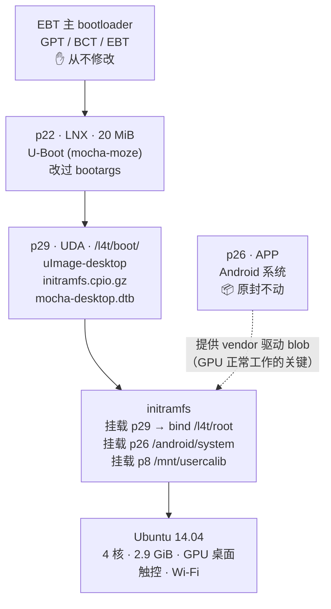

# 小米平板 1（mocha）运行 L4T Ubuntu 14.04 —— 4 核、3GB 内存、GPU 桌面、电源键可用

一份经过实机验证的**完整可复现指南**：在**小米平板 1（代号 `mocha`，Tegra K1 / Tegra124）**
上运行 **Ubuntu 14.04 LTS（NVIDIA L4T R24.1）**，实现：

* ✅ **4 个 CPU 核心**全部在线（**不需要刷 `tos.img`**）
* ✅ **3GB 内存**可用（3GB 硬件改造机型实测 `MemTotal ≈ 2.9 GiB`）
* ✅ **GPU 加速的 Unity 桌面**（NVIDIA Tegra K1 / nvpgpu）
* ✅ **触控**（Atmel mxt1664t）与 **Wi-Fi** 正常
* ✅ **电源键可用**：关机 → 按电源键 → 正常开机
* ✅ **Android 完整保留**——L4T 装在 data 分区里，不碰 Android 分区

> English version: [README.md](README.md)

---

## 1. 核心结论（先说最重要的）

经过一整天的实验（重编内核、改 DTB、挖 PMIC 寄存器），最终可用的配置
**比 L4T 包里的 README 描述的简单得多**：

| 流传的说法 | 实际情况 |
|---|---|
| 「必须刷 `tos.img`，否则只有 1 核」 | ❌ **错**。原版 L4T 内核本身就能拉起 4 核；`tos.img` 会让这台设备变砖 |
| 「必须自己编译内核」 | ❌ **不要**。`L4T_R241.zip` 里的预编译 `zImage` 就是对的；重编内核要么编译不过、要么启动不了 |
| 「通用 bootargs 就够了」 | ❌ **错**。L4T 内核需要它自己的板级参数（`tegraid`/`touch_id`/`otf_key`/`tegra_fbmem`/`displayboard`/`board_info`/`panel_id`……） |
| 「最多只能用 2GB」 | ❌ **错**。内核自带 `CONFIG_ARM_LPAE=y`，改 DTB 内存节点即可解锁 3GB |
| 「关机后按电源键能开机」 | ❌ **默认不行**。厂商的 `palmas_power_off` 会让 PMIC 进入电源键唤不醒的状态，需要用 DTB 修改绕开 |

**黄金法则：用 L4T 包里的「原版内核 + 原版 DTB + 原版 initramfs」，只改下面这四处小地方。**

---

## 2. 前置条件

### 硬件
* 小米平板 1（`mocha`，A0101，Tegra K1 / Tegra124）
* micro-USB 数据线 + 装有 `fastboot` 的电脑
* 可选：3GB 内存硬件改造（2GB 机型也能用，跳过 5.3 即可）

### 电脑上的软件
* `fastboot`（Android platform-tools）
* Linux 环境（WSL2 也可以），需要：
  * `device-tree-compiler`（`dtc`、`fdtput`）
  * `u-boot-tools`（`mkimage`）
  * `git`、`python3`、`cpio`、`gzip`
* **Linaro GCC 4.9**——只有需要重编 U-Boot 时才用得上

### 需要准备的文件
| 文件 | 来源 |
|---|---|
| `L4T_R241.zip`（mocha 的 L4T R24.1 包，作者 **arttttt / Insei**） | 原项目发布页 / 归档 |
| `L4T-kernel-mocha-master.zip`（内核源码 3.10.107） | GitHub `L4T-kernel-mocha` |
| `mocha-moze-boot`（U-Boot 源码） | GitHub `mocha-moze-boot` |
| 官方 Android fastboot 刷机包（`mocha_images_V9.2.4.0…`） | 小米 |
| `root_00.tar.gz`（在 `L4T_R241.zip` 的 `root_dir/` 里） | L4T 包内 |

从 `L4T_R241.zip` 解出到 `L4T_R241/`：

```
root_dir/boot/zImage              # 原版内核（7,818,464 字节）
root_dir/boot/tegra124-mocha.dtb  # 原版 DTB（144,537 字节）
root_dir/boot/initramfs.cpio.gz   # 原版 initramfs（1,027,580 字节）
root_dir/root_00.tar.gz           # Ubuntu 14.04 rootfs
root_dir/rom_info.txt             # 权威的 bootargs 来源
```

---

## 3. 设备分区表（mocha）

**动手前先自己读一遍**：

```sh
cat /proc/partitions
blkid
```

参考布局（16GB / 64GB 机型的前 29 个分区一致）：

| 分区 | 大小 | 用途 |
|---|---|---|
| p8 | 2 MB | calib（面板标定） |
| p18 | 8 MB | factory |
| **p22** | 20 MB | **LNX —— 引导镜像（我们的 U-Boot 装在这里）** |
| **p26** | 1.25 GB | **APP —— Android 系统**（不要动） |
| **p29** | 剩余（约 56 GB） | **UDA —— Android 数据 + 我们的 L4T（`/l4t/`）** |

配套的 `storage.sh` 在布局与原厂不一致时会拒绝写入——这是**故意的保护**。
**永远不要写 GPT。**

### 磁盘布局图（按字节偏移，非等比）

```
 字节偏移
 0                                                                                 58.2 GiB
 │                                                                                     │
 ├──────────┬────────┬─────────────────┬───────────────────────────────────────────────┤
 │ bootloader│  p22   │      p26        │                    p29                        │
 │ GPT / BCT │  LNX   │      APP        │                    UDA                        │
 │   EBT     │ 20 MiB │   1.25 GiB      │                  ~56 GiB                      │
 │0–192 MiB  │192–212 │ 256 MiB–1.49 GiB│          1.49 GiB – 58.2 GiB                  │
 │           │  MiB   │                 │                                               │
 │ ✋绝不修改 │🧭U-Boot│  📱Android 系统  │  📦Android data(56 GB) + L4T(/l4t/root)        │
 └──────────┴────────┴─────────────────┴───────────────────────────────────────────────┘
                              ▲                              ▲
                              │                              │
                   我们写入 p22（20 MiB）      我们的 L4T 全部住在 p29 里，
                   引导 U-Boot 从这里开始        Android 的用户数据也在这里（不冲突）
```

> 分区表本身（GPT）**从不修改**——我们只写 p22（引导镜像）和 p29（数据分区）的内容。

---

## 4. 启动链设计

```
主 bootloader（EBT，从不修改）
  └─ p22 / LNX：U-Boot（mocha-moze，改了 bootargs）
       └─ mmc 0#UDA : /l4t/boot/uImage-desktop     （原版内核，mkimage 封装 zImage）
                      /l4t/boot/initramfs.cpio.gz  （原版 initramfs，分区号已修补）
                      /l4t/boot/mocha-desktop.dtb  （原版 DTB + 3GB 内存 + 电源修复）
            └─ initramfs 挂载 /dev/mmcblk0p29，bind 到 /l4t/root，switch_root
                 └─ Ubuntu 14.04 运行在 p29:/l4t/root（Android 在 p26 完好）
```

所有东西都在 **data 分区**里——这正是原版 multirom L4T 的做法
（`rom_info.txt`：`root_dir="%m/root"`）。

### 启动流程图



---

## 5. 实施步骤

### 5.1 修补原版 initramfs 的分区号

原版 initramfs 写死了 **Shield Tablet** 的分区号，并且当 `/dev/mmcblk0p25` 存在时会
加 LTE 偏移——mocha 有这个分区，于是所有分区号全部错位、挂载失败。

```sh
mkdir og-init && cd og-init
zcat /path/to/L4T_R241/root_dir/boot/initramfs.cpio.gz | cpio -idm --quiet
```

编辑 `init`，把分区定义块换成 mocha 的真实值：

```sh
# mocha (Mi Pad 1) partition map, from live GPT
DATAPART=/dev/mmcblk0p29
SYSPART=/dev/mmcblk0p26
FACTORYPART=/dev/mmcblk0p18
CALIBPART=/dev/mmcblk0p8
CACHEPART=/dev/mmcblk0p28
```

同时把四个额外分区挂载改成「失败不致命」：

```sh
[ -b $CACHEPART ] && $BB mount -t ext4 -o noatime,nodiratime $CACHEPART /root/android/cache 2>/dev/null
[ -b $SYSPART ] && $BB mount -t ext4 -o noatime,nodiratime,ro $SYSPART /root/android/system 2>/dev/null
[ -b $FACTORYPART ] && $BB mount -t ext4 -o ro $FACTORYPART /root/mnt/factory 2>/dev/null
[ -b $CALIBPART ] && $BB mount -t ext4 -o ro $CALIBPART /root/mnt/usercalib 2>/dev/null
```

重新打包：

```sh
find . | cpio -o -H newc --quiet | gzip -9 > initramfs-mocha-data.cpio.gz
```

### 5.2 把原版内核封装成 uImage

原版 `zImage` 是自解压镜像，U-Boot 的 `bootm` 用 `-C none` 的 uImage 就能引导：

```sh
mkimage -A arm -O linux -T kernel -C none \
        -a 0x80008000 -e 0x80008000 \
        -n "L4T-ORIGINAL" \
        -d L4T_R241/root_dir/boot/zImage uImage-desktop
```

### 5.3 DTB 改造一：3GB 内存节点

反编译**原版** DTB，修改内存节点：

```dts
memory@0x80000000 {
    device_type = "memory";
    reg = <0x0 0x80000000 0x0 0x7d000000      /* 低 2GB（2000MB） */
           0x1 0x0 0x0 0x40000000>;            /* 高 1GB @ 4GiB */
};
```

重新编译后**必须确认节点数不变**（原版 DTB 是 887 个）：

```sh
dtc -I dtb -O dts -o og.dts tegra124-mocha.dtb
# 编辑内存节点
dtc -I dts -O dtb -o dtb-3gb.dtb og.dts
dtc -I dtb -O dts dtb-3gb.dtb | grep -c '{'   # 仍然必须是 887
```

### 5.4 DTB 改造二：让电源键能开机（关键！）

删除 palmas 的关机绑定，让内核**停机（halt）**而不是进入 PMIC 软关机状态
（那个状态用电源键唤不醒）：

```sh
dtc -I dtb -O dts -o fix.dts dtb-3gb.dtb
# 在节点 /i2c@7000d000/tps65913/power_pm 中删除这一行：  system-pmic-power-off;
dtc -I dts -O dtb -o dtb-final.dtb fix.dts
```

改完 `MemTotal` 不变，但 `poweroff` 不再调用 `palmas_power_off`。

### 5.5 U-Boot（p22）—— 从 data 分区加载

在 `mocha-moze-boot` 仓库里修改 `overlay/board/xiaomi/mocha/mocha_emmc_boot.env`：

```
boot_debian=setenv fdt_high ffffffff; setenv initrd_high ffffffff; \
  if mmc dev 0 && ext4load mmc 0#UDA 80007fc0 /l4t/boot/uImage-desktop && \
  ext4load mmc 0#UDA 88000000 /l4t/boot/initramfs.cpio.gz; then setenv rdsize ${filesize}; \
  if ext4load mmc 0#UDA 8c000000 /l4t/boot/mocha-desktop.dtb; then \
  fdt addr 8c000000; fdt resize 10000; \
  setenv bootargs <BOOTARGS>; \
  bootm 80007fc0 88000000:${rdsize} 8c000000; fi; fi
```

`<BOOTARGS>` —— 直接用 `rom_info.txt` 里的 `base_cmdline`，**删掉 `mem=…`**，
并把 root 指向 data 分区：

```
tegraid=40.1.1.0.0 otf_key=c765c04dccd12501f0ba2154786d2c92 panel_id=32 memtype=0
tsec=32M@4064M tzram=4M@4058M ddr_die=1024M@2048M section=128M fbcon=rotate:1
commchip_id=0 emc_max_dvfs=0 touch_id=0@2150632068 video=tegrafb no_console_suspend=1
console=ttyS0,115200n8 console=tty0 debug_uartport=lsport,3 sku_override=0
usbcore.old_scheme_first=1 lp0_vec=2896@0xfdfff000 tegra_fbmem=25296896@0xad012000
nvdumper_reserved=0xfd700000 core_edp_mv=1150 core_edp_ma=4000
pmuboard=0x06c8:0x03e8:0x00:0x44:0x04 displayboard=0x8038:0x0000:0x00:0x00:0x00
power_supply=Battery board_info=0x06f4:0x044c:0x03:0x41:0x07
tegraboot=sdmmc gpt gpt_sector=41983 modem_id=1 watchdog=disable
nck=1048576@0xfd700000 rw root=/dev/mmcblk0p29 rootsubdir=/l4t/root
rootfstype=ext4 rootflags=defaults,noatime,nodiratime
```

> ⚠️ **大坑**：U-Boot 的 `dev:part` 语法会把分区号按**十六进制**解析。
> `mmc 0:29` 会被当成 0x29 = 41 → 报 `** Invalid partition 41 **`。
> 必须用 GPT 分区**名字**：`mmc 0#UDA`。

编译：

```sh
cd mocha-moze-boot
JOBS=8 bash tools/build.sh /tmp/uboot-out
python3 tools/pack-android.py /tmp/uboot-out/u-boot-dtb.bin \
        /tmp/uboot-out/u-boot /tmp/uboot-out/mocha-uboot.img
```

### 5.6 写入 p22 并安装 rootfs

用项目的只读 RAM 安装器（`ram-install.cpio.gz` + `storage.sh`）写入 `LNX`（p22）。
然后用任意能挂载 p29 的 Linux（RAM 安装器即可）：

```sh
mount /dev/mmcblk0p29 /mnt
mkdir -p /mnt/l4t/boot /mnt/l4t/root
cp uImage-desktop initramfs-mocha-data.cpio.gz dtb-final.dtb /mnt/l4t/boot/
cd /mnt/l4t/root && tar -xzf -        # 从主机流式传入 root_00.tar.gz
```

Wi-Fi 固件——L4T 内核去 `/etc/firmware`（以及 `/system/vendor/firmware`）找，
而 rootfs 里的文件在 `/lib/firmware`：

```sh
mkdir -p /mnt/l4t/root/etc/firmware
ln -sf /lib/firmware/fw_bcmdhd.bin /mnt/l4t/root/etc/firmware/fw_bcmdhd.bin
ln -sf /lib/firmware/nvram.txt     /mnt/l4t/root/etc/firmware/nvram.txt
```

重启。应该得到 4 核、2.9 GiB 内存、GPU 桌面、触控和 Wi-Fi。

---

## 6. 装好之后：14.04 已 EOL，用国内 `ubuntu-ports` 源

小米平板 1 是 **armhf**，包在 **ports** 档案库里，不在 `ubuntu/`：

```
deb http://mirrors.tuna.tsinghua.edu.cn/ubuntu-ports/ trusty main restricted universe multiverse
deb http://mirrors.tuna.tsinghua.edu.cn/ubuntu-ports/ trusty-updates main restricted universe multiverse
deb http://mirrors.tuna.tsinghua.edu.cn/ubuntu-ports/ trusty-backports main restricted universe multiverse
deb http://mirrors.tuna.tsinghua.edu.cn/ubuntu-ports/ trusty-security main restricted universe multiverse
```

已验证可用的备选：`mirrors.ustc.edu.cn/ubuntu-ports/`、
`mirrors.aliyun.com/ubuntu-ports/`、`mirrors.huaweicloud.com/ubuntu-ports/`。

---

## 7. 验证清单

```sh
uname -r                     # 3.10.108_SmokeR24.1-V3.5.1
nproc                        # 4
grep MemTotal /proc/meminfo  # 约 3,047,956 kB
ls -d /dev/nvhost-gpu /dev/tegra_dc_0 /dev/fb0
ps -ef | grep lightdm        # 桌面在跑
```

**电源测试**：从桌面菜单关机 → 设备停机 → 按电源键 → 应能开机。
（实测连续 3 次成功。）

### 已验证的产物

`scripts/` 下的脚本已用原版 L4T 文件实测，可**逐字节**重现下列产物：

| 文件 | SHA256 |
|---|---|
| `dtb-final-3gb-nopmoff.dtb` | `88fff3bc182ee6c91f12b4f2959d50f8671cca808553bf0000c6ebfddc5344f0` |
| `initramfs-mocha-data.cpio.gz` | `c79697cfd93afb346266504ecc66ae0756c7b54c96bec911f8ded03856571966` |
| `kernel-original-uImage` | `26c4c15a07678d44808736b9efab8276edf9c9a82cc15d006f251a6a2f5f6edc` |
| `uboot-l4t-3gb.img` | `ca277399fde1b7b3015301ce4e2660a9c8c98819151978f2b069ca4dd30b1939` |

产物来源与许可见 [ARTIFACTS.md](ARTIFACTS.md)。

### 脚本用法

每个脚本都支持 `--help`，并且会校验参数：

```sh
./scripts/04-build-dtb-nopmoff.sh --help     # 说明 + 自带验证
./scripts/03-build-dtb-3gb.sh missing.dtb out.dtb
# -> ERROR: input not found: missing.dtb   （退出码 2）
```

| 脚本 | 作用 |
|---|---|
| `01-patch-initramfs.sh` | 把原版 initramfs 的分区号改成 mocha 的 |
| `02-mkimage-kernel.sh` | 原版 zImage → `-C none` uImage |
| `03-build-dtb-3gb.sh` | 3GB 内存节点（自动校验节点数） |
| `04-build-dtb-nopmoff.sh` | **电源键修复**（删除 palmas 关机绑定） |
| `05-build-uboot.sh` | 改 U-Boot 环境变量并生成 p22 镜像 |
| `06-install-to-data.sh` | 安装到 p29 + WiFi 固件软链 |
| `07-fix-login-greeter.sh` | 修复 16.04 升级后的 LightDM / 登录界面（自动登录 + greeter） |
| `08-fix-bluetooth.sh` | **蓝牙修复**（去掉失效的低功耗模式路径） |

根因深度分析：

* [docs/BUG-power-button.md](docs/BUG-power-button.md) —— 电源键黑砖的根因
* [docs/L4T-LOGIN-GREETER-FIX.md](docs/L4T-LOGIN-GREETER-FIX.md) —— 黑屏登录界面、greeter 样式不对、
  以及**进桌面 30 秒后又退回登录页**（16.04 专属问题）
* [docs/L4T-BLUETOOTH-FIX.md](docs/L4T-BLUETOOTH-FIX.md) —— 蓝牙控制器无响应
  （`Can't read local name`、所有 HCI 命令 `tx timeout`）：根因与修复

---

## 8. 故障排查

| 现象 | 原因 | 解决 |
|---|---|---|
| 一直白屏 | `bootm` 拿到的不是 `-C none` 的 uImage | 用 `mkimage -C none` 重新封装 |
| 黑屏、无串口 | 缺板级 bootargs（`tegra_fbmem`/`displayboard`/`board_info`） | 用 `rom_info.txt` 的完整 cmdline |
| `** Invalid partition 41 **` | `mmc 0:29` 被按十六进制解析 | 改用 `mmc 0#UDA` |
| `low-graphics mode` 对话框 | initramfs 没挂载 `/android/system`（vendor blobs）或 `/mnt/usercalib` | 用修补过的原版 initramfs |
| Wi-Fi `dongle image file download failed` | 固件路径不匹配 | 建 `/etc/firmware` 软链 |
| `Failed to initialize the NVIDIA graphics device` | 用了重编的内核 | 换回原版 `zImage` |
| 只有 1 个核 | 刷了 `tos.img` 或用了非 L4T 内核 | 用原版内核，**不要**刷 `tos.img` |
| 关机后电源键无反应 | `palmas_power_off` 的软关机状态 | 见 5.4（改 DTB） |
| `apt` 找不到 armhf 包 | 档案库用错 | 用 `ubuntu-ports` |
| 蓝牙无响应：`Can't read local name`、所有 HCI 命令 `tx timeout` | 低功耗模式（`sleep/lpm` + `--enable_lpm`）睡下去就不醒 | 跑 `scripts/08-fix-bluetooth.sh` 后重启 |
| 蓝牙能工作但别的设备搜不到 | `BD Address: 43:50:C0:00:00:00` —— 手机丢弃带这个占位地址的 inquiry 响应 | `scripts/08-fix-bluetooth.sh` 会每次开机自动写有效 BD_ADDR |

---

## 9. 千万不要做的事

* ❌ **绝对不要刷 `tos.img`** —— 会让设备变砖（恢复需要短接 RCM 测试点）。
* ❌ **绝对不要写 GPT** —— 项目的 `storage.sh` 从不写，请保持。
* ❌ **不要重编内核**（除非你很确定在做什么）—— 3.10.107 源码编不出与出厂
  3.10.108（"Smoke"）等效的内核。
* ⚠️ **不要用桌面菜单里的「挂起」** —— 这台设备的 Tegra LP0 唤醒不可靠。

---

## 10. 致谢

* mocha 的 L4T 移植：**Insei（DbIm）** 与 **arttttt（ArtemkaVZM）** ——
  `L4T-kernel-mocha`、R24.1 包与 "SmokeR24.1" 内核编译。
* U-Boot 移植：**mocha-moze** 项目。
* NVIDIA L4T R24.1 / Android 平台源码。
* 本文档：一次超长调试过程的现场记录，以上所有结论均在
  真机（小米平板 1，3GB 改装）上验证。

## 11. 许可

文档：CC BY-SA 4.0（建议）。
来自上述项目的脚本、二进制保持其原始许可。
